<p align="center">
  <a href="https://karan-panda.is-a.dev">
    
  </a>
</p>

<p align="center">
  I build the unglamorous parts that keep products fast, correct and online.
  Lately, also the parts that let LLMs work with real systems, safely.
</p>

<p align="center">
  <a href="https://karan-panda.is-a.dev"></a>
  <a href="https://www.linkedin.com/in/karanpanda/"></a>
  <a href="mailto:karanpanda1206@gmail.com"></a>
</p>

## `~/about`

```ts
const karan = {
  base:     "Mumbai, IN",
  langs:    ["C#", "Py", "TS", "SQL"],
  ships:    "UI → API → DB → cloud",
  allergic: "slow pages, fat JSON",
  curious:  ["AI agents", "dev tools"],
  loves: {
    games: "indie · Hollow Knight",
    films: ["sci-fi", "superhero"],
    reads: "philosophy, money, minds",
    sketches: true,
  },
};
```

## `~/shipped`

Day job: insurance products, end to end, at ICICI Lombard. The highlights, as a diff:

```diff
+ MCP tools for a prod LLM assistant
+   (~12k peak daily users)
+ Angular → Next.js · Lighthouse 37→93
+ API payload     17 MB → 6 MB
+ browser cache    6 MB → 1.1 MB
+ LLM context     ~65% leaner
+ region failover: config, not code
- Oracle          (now PostgreSQL)
- XML             (now JSON)
```

<sub>The code is private. The diagrams and write-ups live at <a href="https://karan-panda.is-a.dev">karan-panda.is-a.dev</a>.</sub>

## `~/stack`

<p align="center">
  
</p>

## `~/side-quests`

- **Diabetes Decoded**: a hybrid CNN-LSTM model. The paper won *Best Research Paper* at Multicon-W 2024.
- **VANI**: talk to a map. Whisper speech-to-text, Flask and Leaflet.
- **[my-portfolio](https://github.com/karan-panda/my-portfolio)**: my site. Next.js 16, GSAP, view transitions and a 100 accessibility score.

## `~/now`

- Shipping a post-payment KYC flow.
- Moving business logic out of browsers and into APIs, one journey at a time.
- Open to hard backend, full-stack and AI-platform problems.

<br>

<p align="center">
  <sub><code>// if it's slow, i'm probably already profiling it</code></sub>
</p>
